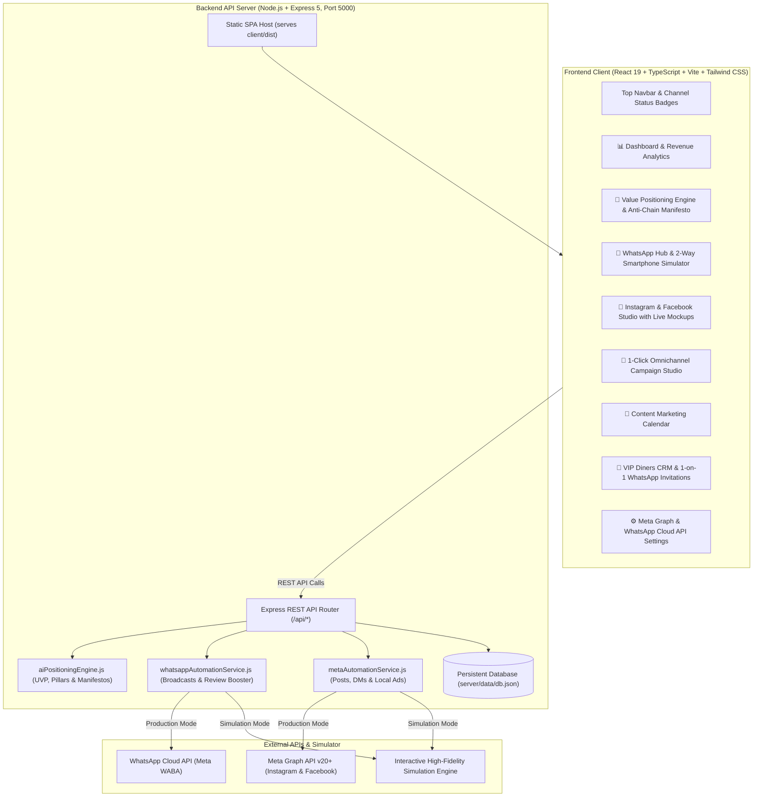

# 🍽️ BistroPulse — AI Omnichannel Marketing & Value Positioning Hub for Local Restaurants

<p align="center">
  
</p>

<p align="center">
  <strong>Automate WhatsApp VIP customer outreach, Instagram Reels & Feeds, and Facebook community engagement — while clearly positioning your authentic culinary value against corporate food chains.</strong>
</p>

<p align="center">
  <a href="#-quick-start"></a>
  <a href="#-tech-stack"></a>
  <a href="#-automated-test-suite"></a>
  <a href="#-license"></a>
</p>

---

## 📖 Table of Contents

1. [The Problem: Why Local Restaurants Struggle](#-the-problem-why-local-restaurants-struggle)
2. [The BistroPulse Solution](#-the-bistropulse-solution)
3. [Core Feature Breakdown](#-core-feature-breakdown)
   - [1. Restaurant Value Positioning Engine](#1-restaurant-value-positioning-engine-position-their-value)
   - [2. WhatsApp Business Cloud Hub](#2-whatsapp-business-cloud-hub)
   - [3. Instagram & Facebook Studio](#3-instagram--facebook-automation-studio)
   - [4. 1-Click Omnichannel Campaign Studio](#4-1-click-omnichannel-campaign-studio)
   - [5. VIP Diners CRM & Loyalty System](#5-vip-diners-crm--loyalty-system)
   - [6. Unified Content Calendar](#6-unified-content-calendar)
4. [System Architecture](#-system-architecture)
5. [Directory Structure](#-directory-structure)
6. [Quick Start & Installation](#-quick-start--installation)
7. [API Reference Guide](#-api-reference-guide)
8. [Connecting Real Meta & WhatsApp Cloud APIs](#-connecting-real-meta--whatsapp-cloud-apis)
9. [Automated Test Suite](#-automated-test-suite)
10. [Troubleshooting & FAQ](#-troubleshooting--faq)
11. [License](#-license)

---

## 🛑 The Problem: Why Local Restaurants Struggle

Independent and local restaurants face two severe structural disadvantages:

1. **The Corporate Franchise Marketing Monopoly:**  
   Fast-food and corporate chains boast multi-million-dollar marketing budgets and full-time media teams. Yet, their food consists of flash-frozen commissary bags, microwave shortcuts, and factory preservatives. Independent chefs craft fresh recipes, hand-roll dough, source from local family farms, and provide real hospitality—**yet diners don't know it because local restaurants fail to clearly position and articulate their value.**

2. **Severe Time Poverty & Marketing Fragmentation:**  
   Chefs and owners work 14+ hours a day managing inventory, prep cooks, supplier delivery slips, and service. They simply do not have time to create separate posts for Instagram, coordinate Facebook groups, draft WhatsApp VIP messages, and follow up with guests for reviews.

---

## 💡 The BistroPulse Solution

**BistroPulse bridges this gap with an all-in-one local restaurant marketing and value positioning platform.**

* **Positions Your Authentic Value:** Generates a custom Anti-Chain Manifesto, Unique Value Proposition (UVP), 3 Core Value Pillars, Sensory Appetite Adjectives, and Target Diner Personas.
* **Automates WhatsApp:** Dispatches VIP broadcasts to regulars (94%+ open rate), runs a 24/7 conversational chatbot on an interactive simulated smartphone, and automatically sends review requests + coupons 2 hours after a diner leaves.
* **Automates Instagram & Facebook:** Creates mouthwatering food captions with local hashtags, provides live smartphone mockups (Feed, Reel, Facebook card), fires instant Comment-to-DM triggers (e.g. comment `MENU` -> instant DM), and generates hyper-local 3-to-5 mile radius Meta ad copy.
* **1-Click Omnichannel Campaigns:** Select a theme (e.g. *Weekend Chef Feature* or *Rainy Day Comfort*) and generate synchronized messaging across WhatsApp, Instagram, and Facebook in one single click.

---

## 🚀 Core Feature Breakdown

### 1. Restaurant Value Positioning Engine ("Position Their Value")

Corporate chains market convenience; independent restaurants win on **authenticity, craft, and human connection**. This engine discovers and packages your restaurant's culinary identity:

* **The Anti-Chain Manifesto:**  
  Generates a bold contrast statement contrasting your kitchen's daily craft against mass-market shortcuts:
  > *"Big restaurant chains ship frozen pre-made sauce in plastic bags from distribution centers 900 miles away. Chef Marco lights our oakwood fire at 6:00 AM, reducing locally harvested tomatoes and simmering farm herbs. When you dine with us, you are keeping culinary artistry alive and supporting local farmers."*
* **Core Unique Value Proposition (UVP):**  
  A punchy, memorable 1-sentence statement calibrated for social media bios, Google Maps headers, and press mentions:
  > *"Where Oakville experiences real culinary soul: zero shortcuts, daily hand-rolled pasta & 48-hour fermented sourdough crusts, and genuine hospitality you simply cannot mass-produce."*
* **The 3 Value Pillars:**
  1. *Uncompromising Craftsmanship:* Morning scratch kneading, 48-hour fermentation, open-fire roasting.
  2. *Hyper-Local Provenance:* Sourced directly from local micro-farms within a 35-mile radius.
  3. *The Lost Art of Real Hospitality:* Guests treated like family, personalized table greetings, unhurried meals.
* **Sensory Appetite Vocabulary:**  
  Curated vocabulary list of sensory descriptors (*velvety*, *oakwood flame*, *simmered for 6 hours*, *hand-pinched*, *imported San Marzano*) with commodity fast-food terms (*cheap food*, *fast turnover*, *microwaved*) strictly flagged and forbidden.
* **Target Diner Personas:**  
  Tailored marketing angles for *The Meaningful Date-Nighters*, *The Weekend Family Feast*, and *The Discerning Foodie*.
* **Printable Staff Brand Sheet:**  
  A 1-click printable guide so front-of-house servers and kitchen line cooks stay aligned on the restaurant's value story.

---

### 2. WhatsApp Business Cloud Hub

With a **94% to 98% open rate** (compared to 18% for email), WhatsApp is the most lucrative marketing channel for local restaurants:

* **VIP Customer Broadcast Engine:**  
  Filter diners by audience segment (*VIP Regulars*, *Lunch Regulars*, *Date Night Regulars*, *Inactive 30+ Days*) and send rich broadcast messages with dynamic personalization tags:
  `Ciao {{name}}! Chef Marco just pulled fresh Truffle Gnocchi from the oven. As our VIP, enjoy a complimentary Chianti tonight!`
* **Automated Post-Dining Review & Loyalty Booster:**  
  Automatically triggers 2 hours after a diner's bill is closed. Sends a warm message thanking them for dining, providing a direct 1-tap Google Review link, and delivering a promo coupon code (e.g. *Complimentary Tiramisu*) for their next visit.
* **Interactive 2-Way Smartphone Chatbot Simulator:**  
  A realistic interactive smartphone mockup right in the web app! Test incoming keywords (`MENU`, `BOOK`, `SPECIAL`, `HOURS`) or freeform text and watch the automated bot reply in real time.
* **Keyword Trigger Manager:**  
  Easily add and edit auto-replies for custom keywords (e.g., `WINE`, `CATERING`, `HALAL`, `PARKING`).

---

### 3. Instagram & Facebook Automation Studio

* **Culinary Angle Caption Generator:**  
  Choose from high-converting food storytelling angles:
  - *Behind-the-Scenes Prep at 7 AM* (flour dusting, rolling pins, kitchen steam)
  - *Signature Sizzle Pull* (stretching cheese, bubbling wood-fired crust)
  - *Farm-to-Table Provenance* (harvest boxes, local grower spotlights)
  - *Intimate Date Night* (candlelit corner booths, regional wine pairings)
* **Multi-Mode Smartphone Previewer:**  
  Toggle between:
  - **Instagram Feed Post:** Square photo, username badge, like counts, caption expander, and hashtags.
  - **Instagram Reel:** 9:16 vertical video layout with audio track credit, sticker CTA, and like/comment counters.
  - **Facebook Community Card:** Header, public post badge, photo preview, and "Book Now" / "WhatsApp" action buttons.
* **Comment-to-DM Growth Engine (Viral Growth Loop):**  
  When an Instagram user comments on your post with a trigger keyword (e.g. `MENU` or `BOOK`), Meta automatically triggers a private DM to that user with off-menu specials and direct table reservation links. Includes an interactive testing simulator!
* **Hyper-Local Meta Ad Studio:**  
  Generates targeted ad copy variations with a 3-to-5 mile radius geo-targeting ring around the restaurant address.

---

### 4. 1-Click Omnichannel Campaign Studio

Local restaurant owners don't have time to create separate posts across multiple apps:
1. **Choose a Proven Restaurant Theme:**
   - *Weekend Artisanal Chef Feature* (Craft & Scarcity)
   - *Rainy Day Hearth & Comfort Drop* (Cozy Nostalgia & Flash 15% discount)
   - *Secret Off-Menu VIP Night* (Loyalty Retention)
   - *Sunday Neighborhood Family Feast* (Community Volume)
2. **Synchronized Generation:**  
   Instantly generates coordinated copy across **WhatsApp, Instagram, and Facebook** simultaneously.
3. **Side-by-Side Review:**  
   Edit each channel's text side-by-side with optimal posting time recommendations.
4. **1-Click Launch:**  
   Dispatches the WhatsApp VIP broadcast, schedules the Instagram Reel, and publishes the Facebook community update in one action!

---

### 5. VIP Diners CRM & Loyalty System

* **Diner Directory:** View customer names, phone numbers, visit counts, last visit dates, favorite signature dishes, and lifetime spend.
* **Smart Segmentation:** Group guests into *VIP Regulars*, *Lunch Regulars*, *Date Night Regulars*, *First-Timers*, or *Inactive (30+ Days)*.
* **Direct 1-on-1 Outreach:** Click *"Send WhatsApp"* on any diner to open a pre-personalized WhatsApp message box referencing their favorite dish.
* **Add New Diners:** Quick modal to register new walk-in regulars or loyalty program signups.

---

### 6. Unified Content Calendar

* Visual schedule of all published, scheduled, and draft marketing drops.
* Filter by channel: **All**, **WhatsApp**, **Instagram**, **Facebook**.
* Filter by status: **Scheduled**, **Published**, **Draft**.
* Quick *"Schedule New Post"* modal with date and time pickers.

---

## 📐 System Architecture



---

## 📂 Directory Structure

```
bistropulse/
├── client/                               # Frontend React + TypeScript application
│   ├── src/
│   │   ├── components/                   # Core application modules
│   │   │   ├── Navbar.tsx                # Header navigation & channel status pills
│   │   │   ├── DashboardTab.tsx          # Overview, health score, quick launchpads
│   │   │   ├── ValuePositioningTab.tsx   # UVP, anti-chain manifesto, value pillars
│   │   │   ├── WhatsAppTab.tsx           # VIP broadcasts, smartphone bot simulator
│   │   │   ├── SocialMediaTab.tsx        # Instagram/Facebook creator & live phone mockups
│   │   │   ├── CampaignStudioTab.tsx     # 1-Click omnichannel campaign studio
│   │   │   ├── CalendarTab.tsx           # Content calendar & post scheduler
│   │   │   ├── CrmTab.tsx                # VIP Diners directory & 1-on-1 outreach
│   │   │   └── SettingsTab.tsx           # Meta/WhatsApp API credentials & simulation toggle
│   │   ├── services/
│   │   │   └── api.ts                    # REST API client for backend endpoints
│   │   ├── types/
│   │   │   └── index.ts                  # Full TypeScript interface definitions
│   │   ├── App.tsx                       # Root application state & toast notifications
│   │   └── index.css                     # Warm culinary styling & Tailwind utilities
│   ├── dist/                             # Compiled production build
│   ├── tailwind.config.js                # Custom restaurant color palette
│   ├── vite.config.ts                    # Vite bundler configuration & /api proxy
│   └── package.json                      # Client dependencies
│
├── server/                               # Backend Node.js Express application
│   ├── data/
│   │   ├── store.js                      # Persistent JSON store manager
│   │   └── db.json                       # Database file (pre-seeded with trattoria data)
│   ├── services/
│   │   ├── aiPositioningEngine.js        # Value matrix, anti-chain manifestos, campaigns
│   │   ├── whatsappAutomationService.js  # WhatsApp Cloud API & 2-way bot handler
│   │   └── metaAutomationService.js      # Meta Graph API, comment-to-DM & local radius ads
│   ├── index.js                          # Express application entry & SPA static server
│   ├── test.js                           # 10-suite unit & integration test runner
│   ├── e2e-check.js                      # End-to-end HTTP endpoint verification script
│   └── package.json                      # Server dependencies (Express, CORS)
│
├── docs/                                 # Detailed documentation guides
│   ├── API_DOCUMENTATION.md              # Complete REST API reference
│   ├── VALUE_POSITIONING_PLAYBOOK.md     # Restaurant value positioning strategy guide
│   └── META_AND_WHATSAPP_SETUP_GUIDE.md  # Step-by-step Meta developer portal setup
│
├── package.json                          # Unified root npm scripts
└── README.md                             # Comprehensive project documentation
```

---

## ⚡ Quick Start & Installation

### Prerequisites
* **Node.js:** v18.0.0 or later (v20+ or v24+ recommended)
* **NPM:** v9.0.0 or later

### Step 1: Clone / Navigate to Directory
```bash
cd C:\Users\Malaika\.gemini\antigravity\scratch\bistropulse
```

### Step 2: Install Dependencies
```bash
# Install root, server, and client dependencies
npm install
npm --prefix server install
npm --prefix client install
```

### Step 3: Run the Application
```bash
# Starts the fullstack application on Port 5000
npm start
```

Open your browser and navigate to:
👉 **`http://localhost:5000`**

### Step 4: Development Mode (Optional with Hot Reload)
If you wish to make changes to frontend code with instant Vite Hot Module Replacement:
```bash
# Terminal 1: Backend API
npm run server

# Terminal 2: Frontend Vite Dev Server
npm run client
```
Open **`http://localhost:3000`** (requests to `/api` are automatically proxied to port 5000).

---

## 🔌 API Reference Guide

All REST API endpoints are prefixed with `/api` and return clean JSON payloads:

### Restaurant Profile
* `GET /api/restaurant` — Fetch current restaurant profile (name, cuisine, signature dishes, differentiators).
* `PUT /api/restaurant` — Update restaurant details.

### Value Positioning Engine
* `GET /api/positioning` — Fetch current Value Positioning Matrix (UVP, Anti-Chain Manifesto, Pillars, Brand Voice).
* `POST /api/positioning/generate` — Trigger AI to analyze the restaurant's cuisine, craft, and neighborhood and regenerate the matrix.
* `GET /api/positioning/audit` — Compute the **Value Health Score (0-100%)**, grade, strengths, and recommendations.
* `PUT /api/positioning` — Save manual edits to UVP, manifesto, or pillars.

### WhatsApp Automation
* `POST /api/whatsapp/send` — Send a single WhatsApp message (`{ to, text, customerName }`).
* `POST /api/whatsapp/broadcast` — Dispatch broadcast to segment (`{ segment, customMessage }`).
* `POST /api/whatsapp/chat-simulator` — Simulate incoming user text (`{ from, text, senderName }`). Returns automated bot response.
* `POST /api/whatsapp/review-booster` — Trigger automated 2-hour post-dining review request with coupon incentive (`{ customerId }`).

### Meta Graph API (Instagram & Facebook)
* `POST /api/meta/instagram/publish` — Publish or simulate Instagram post (`{ caption, imageUrl, mediaType }`).
* `POST /api/meta/facebook/publish` — Publish or simulate Facebook Page post (`{ message, link }`).
* `POST /api/meta/instagram/comment-trigger` — Simulate comment on post (`{ username, commentText }`). Fires automated private DM.
* `GET /api/meta/ads/local-radius` — Generate 3-to-5 mile radius Meta ad copy and audience parameters.

### Campaigns & Calendar
* `GET /api/campaigns` — List all campaigns.
* `POST /api/campaigns/generate` — Generate 1-click omnichannel campaign (`{ theme, targetSegment }`).
* `POST /api/campaigns` — Save new campaign.
* `GET /api/calendar` — List scheduled and published posts.
* `POST /api/calendar` — Schedule a new post.
* `DELETE /api/calendar/:id` — Delete a scheduled post.

### CRM & Analytics
* `GET /api/customers` — List all diners with tags, visit history, and lifetime spend.
* `POST /api/customers` — Add a new diner.
* `GET /api/analytics` — Dashboard metrics (total reach, table bookings, WhatsApp read rates, estimated revenue).
* `GET /api/logs` — Live activity log stream.
* `POST /api/settings/reset` — Reset all data back to the default sample trattoria.

---

## 🔑 Connecting Real Meta & WhatsApp Cloud APIs

BistroPulse comes with an **Interactive Simulation Mode** enabled by default, allowing you to test broadcasts, review boosters, chatbot interactions, and comment triggers without needing active Meta developer accounts.

When you are ready to connect your restaurant's live social media accounts:

1. **Open BistroPulse:** Navigate to the **Settings & APIs** tab in the top navigation bar.
2. **Meta Graph API (Instagram & Facebook):**
   - Uncheck *Simulation Mode*.
   - Enter your **Facebook Page ID** (found in Facebook Page Settings > About).
   - Enter your **Instagram Business Account ID** (found in Meta Business Suite > Linked Accounts).
   - Enter your **System User Access Token** (generated in [Meta for Developers](https://developers.facebook.com) under Business Settings > System Users with `pages_manage_posts`, `instagram_basic`, and `instagram_content_publish` permissions).
3. **WhatsApp Cloud API:**
   - Uncheck *Simulation Mode*.
   - Enter your **Phone Number ID** from your Meta WhatsApp Cloud API App dashboard.
   - Enter your **WhatsApp Business Account ID (WABA ID)**.
   - Enter your permanent **WhatsApp Cloud API Bearer Token**.
4. Click **Save Configuration**. All campaign dispatches, broadcasts, and DM triggers will now execute in real-time through Meta's production servers.

*For full instructions with step-by-step screenshots, see [docs/META_AND_WHATSAPP_SETUP_GUIDE.md](docs/META_AND_WHATSAPP_SETUP_GUIDE.md).*

---

## 🧪 Automated Test Suite

BistroPulse includes both a unit test suite and an end-to-end integration verification script:

### Run the 10-Suite Automated Test
```bash
npm test
```
**Test Results:**
```
🧪 Starting BistroPulse Automated Test Suite...

✅ Test 1 Passed: Restaurant Profile loaded correctly
✅ Test 2 Passed: Value Positioning Engine generated authentic USP & Anti-Chain Manifesto
✅ Test 3 Passed: Positioning Audit Score = 100/100 (A+ Culinary Destination)
✅ Test 4 Passed: WhatsApp 2-Way Chatbot correctly handles MENU trigger
✅ Test 5 Passed: WhatsApp Broadcast dispatched to VIP contacts
✅ Test 6 Passed: Post-Dining Review Booster generated with loyalty incentive
✅ Test 7 Passed: Instagram post simulated with 3,495 estimated reach
✅ Test 8 Passed: Instagram Comment-to-DM growth trigger fired successfully
✅ Test 9 Passed: Hyper-local radius Meta Ads generated
✅ Test 10 Passed: Omnichannel 3-channel synchronized campaign generated

🎉 ALL 10 TEST SUITES PASSED FLAWLESSLY!
```

### Run End-to-End HTTP Verification
```bash
node server/e2e-check.js
```
Verifies all REST endpoints and validates that the frontend Single Page Application (SPA) HTML is served with HTTP 200.

---

## ❓ Troubleshooting & FAQ

#### Q: The app says "Simulation Mode" — can I use it without Meta API keys?
**A:** Yes! Simulation mode is 100% functional out of the box. You can test VIP broadcasts, review booster incentives, the smartphone chatbot, and Instagram Comment-to-DM triggers. All actions are recorded in the live Activity Log.

#### Q: How do I change the restaurant profile to my own restaurant?
**A:** Go to the **Settings & APIs** tab, scroll to **Restaurant Profile & Local Identity**, update your restaurant name, cuisine style, city, address, and tagline, and click **Save Configuration**. Then visit the **Value Positioning** tab and click **AI Re-Calibrate** to instantly generate a custom Value Positioning Matrix and Anti-Chain Manifesto for your specific cuisine!

#### Q: How does the Post-Dining Review Booster work?
**A:** When a diner finishes their meal, BistroPulse schedules a friendly WhatsApp message 2 hours later. The message asks if they enjoyed their experience, includes a direct link to your Google Maps review page, and rewards them with an incentive coupon code (e.g. *Complimentary Tiramisu* or *15% off*) for their next visit.

#### Q: Can I run BistroPulse in Docker or deploy to the cloud?
**A:** Yes! Because BistroPulse uses standard Node.js and Express to serve both the API and the compiled React frontend, it can be deployed with 1 click to Railway, Render, Fly.io, Heroku, or any VPS running PM2.

---

## 📄 License

This project is licensed under the **MIT License** — you are free to use, modify, and deploy BistroPulse for your own restaurant or for client restaurants.

---

<p align="center">
  <strong>Built with ❤️ for independent local restaurants everywhere.</strong>
</p>
